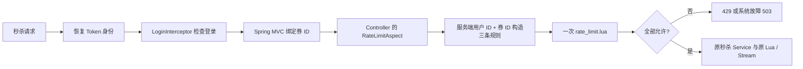

# Redis 限流与登录防刷开发总结

日期：2026-11-11。已按 Task 1～7 顺序完成实现、独立代码审阅和最终回归：**84 项通过，失败 0、错误 0、跳过 0，Maven 退出码 0**。其中 32 项真实 Redis 用例在用户授权的 DB15 执行，另外 52 项为 Java/MockMvc 与既有基础回归。

## 1. 实现范围与实际状态

| Task | 已实现内容 | 当前证据与限制 |
| --- | --- | --- |
| 1 | 固定窗口、严格冷却、一次 Lua 多维准入、配置/Key/安全异常 | 7 项适配层 + 10 项真实 Redis 测试通过 |
| 2 | 自定义注解、AOP、可信 IP、429/400/503 | 8 项 AOP/MockMvc + 3 项真实 IP 窗口测试通过 |
| 3 | 只在秒杀 Controller 添加 SECKILL 准入 | 6 项路由/身份/阻断测试通过；含依赖回归共 34 项通过 |
| 4 | 验证码签发、冷却/配额、MockSmsSender、所有权补偿 | 10 项协调层 + 6 项真实 Redis 测试通过 |
| 5 | 原子比较/计错/消费、登录接入、数据库异常脱敏 | 6 项协调层 + 7 项真实 Redis 测试通过，包含同码 50 并发仅一次成功 |
| 6 | Token 原子创建/续期、ThreadLocal 清理、幂等退出 | 8 项适配层 + 3 项真实 Redis 测试通过，包含退出后 401 和续期竞争 |
| 7 | 异常输入、超时、统一错误文案、日志与回归 | 6 项契约 + 3 项真实 Redis 契约通过；最终模块共 84 项通过 |

执行途中每个 Task 先加入测试并运行，观察组件/方法缺失或行为断言失败，再实施最小代码。初期缺少隔离测试配置时保留了明确的环境错误；用户授权复用现有连接并选择 DB15 后，逐 Task 补齐全部真实 Redis 验证。没有把 mock 当作 Redis 原子性证明，没有删除或禁用失败用例。

独立审阅修正包括重复 X-Real-IP 多字段、损坏短信字符串状态及越界 Token 用户 ID。重复头用例先失败再通过；对 Lua 修正还执行了受控回退验证：临时撤回本次新增的三处校验时，三项回归测试均失败（失败 3、错误 0、跳过 0、退出码 1），finally 按原字节恢复后，最终 84 项回归全部通过。旧库存 Lua 从未参与回退。

本次遵循用户最新授权连续执行，不按旧文档逐 Task 询问。用户后续明确要求保留 application.yaml，因此保护规则由 ProtectionProperties 的默认值提供；UserMapper 的 INFO 日志覆盖通过本模块启动初始化设置，不改 YAML。

## 2. 主要代码位置

下面均为仓库相对路径。

- `src/main/java/com/hmdp/config/ProtectionProperties.java`：保护默认值、参数校验、敏感 Mapper 日志保护。
- `src/main/java/com/hmdp/utils/ProtectionKeys.java`、`RedisConstants.java`：统一前缀与隔离命名空间。
- `src/main/java/com/hmdp/ratelimit/`：RateLimit、RateLimitPolicy、RateRule、RedisRateLimiter、RateLimitAspect、策略与 IP 解析器。
- `src/main/java/com/hmdp/auth/`：SmsCodeService、SmsSender/MockSmsSender、TokenSessionService。
- `src/main/java/com/hmdp/exception/`：参数非法、准入拒绝、保护不可用三类安全异常。
- `src/main/resources/lua/protection/`：六个新增脚本，分别负责复合准入、签发、补偿、消费、Token 创建与续期。
- `src/main/java/com/hmdp/controller/UserController.java`、`VoucherOrderController.java`：注解接入、退出请求参数。
- `src/main/java/com/hmdp/service/IUserService.java`、`impl/UserServiceImpl.java`：认证组件接入与安全数据库异常处理。
- `src/main/java/com/hmdp/utils/RefreshTokenInterceptor.java`、`config/MvcConfig.java`：会话恢复、清理及退出放行。
- `src/main/java/com/hmdp/config/WebExceptionAdvice.java`：安全 HTTP 协议；包括参数绑定阶段的认证入口错误。
- `src/test/java/com/hmdp/protection/`：单测、最小 MockMvc 用例和显式配置的真实 Redis 用例。
- `pom.xml`：仅新增由现有 Boot 父工程管理版本的 AOP Starter。

未改变 Java 8 和现有依赖版本；原 `seckill.lua`、`VoucherOrderServiceImpl.java`、数据库脚本、用户 Redis 配置及 application.yaml 均与执行前哈希一致。没有提交、覆盖或暂存用户改动。

## 3. 三维秒杀限流怎样工作



三个维度有不同用途：

| 维度 | 初始规则 | 为什么需要 |
| --- | --- | --- |
| 优惠券 | 每 1 秒固定窗口 100 次 | 限制单券进入业务的总流量 |
| 用户 | 每 10 秒固定窗口 5 次 | 防止同一用户切换券 ID 绕过 |
| 用户 + 优惠券 | 放行后严格冷却 2000ms | 抑制同一人的重复点击，跨整秒也不能提前放行 |

固定窗口使用 Hash 保存窗口号和计数。例如一个窗口允许 5 次，第 6 次拒绝；到了下一个窗口重新计数。边界附近仍可能集中通过请求，这是固定窗口的特性。

严格冷却保存下一次允许时间，而不是窗口号。第一次在 00.900 秒放行，下一次最早在 02.900 秒放行；02.000 秒仍然拒绝。

脚本先检查所有维度，再同时更新。不能先扣优惠券额度、发现用户超额后再回滚，否则并发下容易产生部分扣额。被限流拒绝不会改变其他额度；进入原业务后即使库存不足，也不退准入额度。

用户维度取 UserHolder 中服务端恢复的用户 ID。重新登录得到另一个 Token，不会获得新的用户额度。

## 4. 验证码防刷怎样工作

发送链路：IP AOP 准入 → 校验手机号 → 生成安全随机六位码与签发 ID → Lua 检查手机号锁定、60 秒冷却、自然小时 5 次和北京时间自然日 10 次 → 原子写码并扣配额 → MockSmsSender。

校验链路：IP AOP 准入 → Lua 检查锁定 → 比较验证码 → 错误时计数，15 分钟内第 5 次错误锁定 15 分钟 → 正确时原子删除验证码、签发 ID、失败计数 → 查询/注册用户 → 创建 Token。

重发不会清空失败次数，锁定期间也不能通过重发解锁。冷却只限制发送，不阻止正常用户使用已有的有效码登录。普通错误、过期、缺失或已使用统一返回“验证码错误或已失效”，不查询或透露是否已注册。

验证码的比较和删除必须放在一个脚本里。Java 先 GET 再比较、再 DEL，会给两个并发请求都看到正确码的机会。真实 Redis 测试中，相同正确码发起 50 个并发请求，恰好一次消费成功，另外 49 次失败；重发与旧码校验竞争也验证了新码不会被旧请求误删。

短信结果不能与 Redis 组成一个事务，因此分开处理：

| 通道结果 | 状态处理 | 接口结果 |
| --- | --- | --- |
| 明确接受 | 保留本次有效验证码 | 成功，仅表示模拟通道接受 |
| 明确失败 | 仅当签发 ID 仍属于本次请求时删除本次码 | 503 |
| 超时/结果不确定 | 保留码，迟到短信仍可使用 | 503 |

三种情况都不自动重发。失败不返配额、不解除冷却、不恢复旧码，防止通过反复制造失败绕过保护。签发 ID 防止旧请求的失败补偿删掉后来重发的新码。当前没有实际短信或付费服务调用，日志也不提供“查看验证码”的后门。

## 5. Token 退出与 ThreadLocal

登录成功返回原格式随机 Token，并通过 Lua 同时写入用户 Hash 和 TTL。36000 分钟换算为 2160000000 毫秒，已经超过 int 最大值，因此计算使用 long。

请求进来后，RefreshTokenInterceptor 调用 TokenSessionService 原子读取与续期，然后才把用户 DTO 放入 UserHolder。UserHolder 只是当前线程上的请求身份，不是登录凭证仓库。

退出执行 `DEL login:token:<当前Token>`；重复或过期退出仍成功。Redis 删除异常返回 503，不报告成功。退出后的新请求恢复不到身份，在受保护接口被 LoginInterceptor 返回 401。已经完成认证的在途请求可能继续执行，本模块没有强制撤销在途请求。

请求结束或恢复身份异常时清理 ThreadLocal，避免 Servlet 线程池复用线程时串用上一请求的身份。

## 6. 关键技术点

| 技术 | 在本项目中的作用 |
| --- | --- |
| Spring AOP | 通过注解在 Controller 方法前复用限流，不复制业务判断；内部自调用/其他 Service 入口不会自动受保护 |
| Redis Lua | 把检查、计数、TTL 与必要删除放在同一次服务器端执行中；当前仅保证同一 Redis 实例内不被其他请求插入 |
| 固定窗口与冷却 | 一个限制某段时间的次数，一个限制两次成功之间的最短间隔，不能混用 |
| ThreadLocal | 保存本请求身份，必须在完成和异常路径清理；它本身不能让 Redis Token 失效 |
| Spring MVC | 拦截器负责身份与访问控制，参数绑定发生在业务方法前，Advice 把保护结果映射为 429/400/503 |
| 故障关闭 | Redis 无法确认准入时拒绝，不降级为每实例各算一份的本地计数器，不重放结果不确定的非幂等脚本 |

Lua 原子执行不等于发生错误自动回滚，也不能把 Redis、MySQL 和短信厂商合成一个事务。脚本因此先校验所有状态，再开始写入，并让所有临时状态有正确 TTL。

## 7. 实际测试命令与结果

使用 Java 8，在当前 shell 临时指定 JAVA_HOME，运行后恢复。没有改系统环境变量。由于本机默认 Maven 镜像/缓存受限，本次使用项目内临时设置与缓存补齐原版本依赖，未改现有 Maven 配置：

```powershell
$env:JAVA_HOME = 'D:\JAVA\wjzjdk8' # 仅当前进程；实际执行包裹在 try/finally 中恢复
$mavenArgs = @(
  '-o',
  '-s', 'target/protection-execution/offline-settings.xml',
  '-gs', 'target/protection-execution/offline-settings.xml',
  '-Dmaven.repo.local=D:\JAVA\jz-dianping\target\protection-maven-repo',
  '-Dhmdp.test.redis.config=src/main/resources/application.yaml',
  '-Dhmdp.test.redis.database=15'
)
```

`offline-settings.xml` 是本次生成的临时空 Maven settings，缓存只读复制已有文件并补齐同版本缺失依赖。它们在已忽略的 target 下；clean 后会消失，不属于业务配置。正常联网且缓存完整的环境可直接使用 `mvn -Dtest=... test`。

各 Task 执行的筛选参数与实际记录：

| 执行 | Maven `-Dtest` | 测试数 | 失败 | 错误 | 跳过 | Maven 退出码 |
| --- | --- | ---: | ---: | ---: | ---: | ---: |
| 基线 | NormalTest | 1 | 0 | 0 | 0 | 0 |
| Task 1 真实验证 | ProtectionRateLimiter*Test | 17 | 0 | 0 | 0 | 0 |
| Task 2 真实验证 | ProtectionRateLimitAspectTest,ProtectionIpRateRedisTest | 11 | 0 | 0 | 0 | 0 |
| Task 3 依赖回归 | ProtectionRateLimiter*Test,ProtectionRateLimitAspectTest,ProtectionIpRateRedisTest,ProtectionSeckillRateLimitTest | 34 | 0 | 0 | 0 | 0 |
| Task 4 真实验证 | ProtectionSmsSend*Test | 16 | 0 | 0 | 0 | 0 |
| Task 5 真实验证 | ProtectionSmsVerify*Test | 13 | 0 | 0 | 0 | 0 |
| Task 6 真实验证 | ProtectionTokenSession*Test | 11 | 0 | 0 | 0 | 0 |
| Task 7 真实契约 | ProtectionContract*Test | 9 | 0 | 0 | 0 | 0 |
| 最终完整模块 | Protection*Test,NormalTest | 84 | 0 | 0 | 0 | 0 |

完整模块命令是：

```powershell
& mvn @mavenArgs '-Dtest=Protection*Test,NormalTest' test
```

本次不需要任何 Windows 系统环境变量。上面的两个 `-D` 参数只在本次 Maven/JUnit 进程中生效：只读复用 YAML 中的 host/port/password，单独选 DB15，并拒绝与 YAML 中业务逻辑库相同的选择。既有 `HMDP_TEST_REDIS_*` 方式仍兼容，但只有未明确选择 YAML 模式时才使用，不自动回退到业务连接。

每个真实 Redis 用例使用独立 `test:protection:<runId>:` 前缀，只删除已登记的本次测试 Key；未使用 FLUSHDB/FLUSHALL。连接、密码、原始验证码与 Token 不输出到日志。

完整原始执行日志在 `target/protection-execution/`，最终日志为 `final-verified.log`，JUnit XML 在 `target/surefire-reports/`。原 HmDianPingApplicationTests 和 RedissonTest 会启动原应用/写业务 Redis，因此此次没有运行，也没有删掉或禁用；上述结果只覆盖新模块与原纯 Java NormalTest，不代表仓库所有旧集成测试已执行。

中文 JavaDoc 使用 Java 8 的 `javadoc -Xdoclint:all,-missing` 对涉及的主代码检查，退出码为 0；`git diff --check` 通过。没有做未授权的提交、合并或推送。

## 8. 实施时作出的决定与剩余问题

- 使用实际存在的 `docs/superpowers/specs` 和 `docs/superpowers/plans` 同名文档；没有在用户给出的缺失路径创建另一套规范。
- 用户最新指令覆盖旧文档的逐 Task 暂停，顺序连续执行；在已有工作区保留未提交修改，没有修改 Git 元数据或创建实现提交。
- 没有修改 application.yaml；规则默认值与敏感 SQL 日志设置由本模块提供。
- 临时 Maven 设置/缓存只用于运行原版本依赖，不替换用户配置、不升级依赖。
- 修复了测试发现的本模块参数绑定阶段 200/原异常日志问题；对非本模块接口保留原 RuntimeException 行为。
- 用户明确授权复用现有连接在 DB15 测试后，已补齐真实 Lua、TTL、竞争及退出验证；没有重新部署 Redis、修改 YAML 或设置系统环境变量。
- 审阅修正已验证：重复代理头回退直连地址；损坏 code/issue/lock 返回内部状态错误而不扣额；超过 Long.MAX_VALUE 的 Token ID 不续期。审阅对 Token 上界原列 Minor，本次按“无效凭证不应持续续写”的实际影响提升为需修正项，无保留未修 Minor。
- 第一次切换实现前等待旧验证码最多两分钟自然到期，避免新保护流程与旧签发状态混用；已有 Token 数据结构兼容。
- 当前是单实例 Redis，不支持直接迁移多槽 Cluster Lua；也不能承诺 Redis 故障后的数据持久化。
- 固定窗口边界突发、共享出口 IP 误伤和恶意手机号锁定仍有边界；阈值需要实际观测校准。
- Nginx 部署时必须明确可信代理并覆盖 X-Real-IP；默认忽略外部转发头，不能直接信任客户端自报 IP。
- 原订单 Stream ACK 名称不一致、订单数据库事务与可靠性问题保持原样，不属于本期修复。
- 验证码消费后的数据库失败不恢复旧码，并发注册唯一性处理沿用原逻辑；测试对 MySQL 使用 Mapper 替身，没有生产数据库写入或跨库事务验证。

## 9. 实习简历技术亮点

以下内容基于已经实现并通过的模块测试。并发消费的正确性验证不是吞吐压测，不能据此推导 QPS。

- 基于 Spring AOP 与自定义注解封装接口准入组件，按服务端策略复用 IP、用户及业务资源维度限流，并统一返回 HTTP 429 和重试时间。
- 设计优惠券 1 秒固定窗口、用户 10 秒固定窗口、用户与优惠券严格两秒冷却，通过单次 Redis Lua 完成多维检查与统一扣额，避免部分扣减。
- 实现验证码发送冷却、自然小时/日配额、失败次数与临时锁定，使用 Lua 比较并消费验证码，重发保留失败记录。
- 使用签发 ID 校验短信失败补偿所有权，区分明确失败与超时未知结果，避免旧请求删除新验证码或盲目重发。
- 基于 Redis Token 和双拦截器实现会话续期、幂等退出及 ThreadLocal 清理；通过 84 项模块与基础回归测试，覆盖真实 Redis 的同码 50 请求并发消费、重发竞争和退出后旧 Token 返回 401。

本项目未采集 QPS、P99、成本下降率、拦截率或短信送达率，不填写这些性能或业务收益数据。
