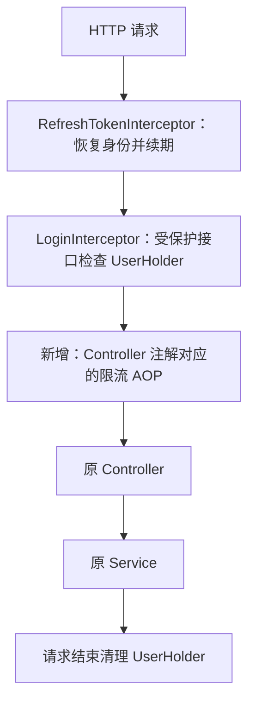
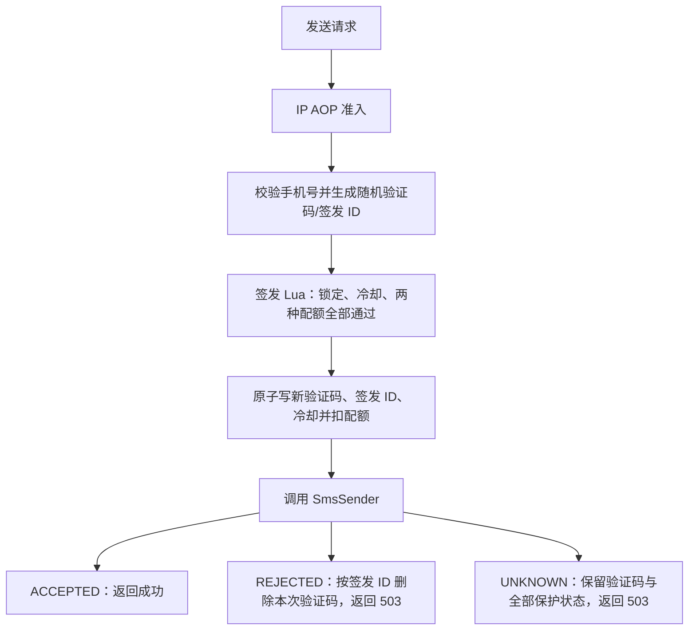

# Redis 限流与登录防刷模块设计

日期：2026-11-11（Asia/Shanghai）

状态：根据已确认候选方案 A 和用户修订形成的正式设计，等待文档审阅；不授权开始业务实现。

项目：黑马点评二次开发，`D:\JAVA\jz-dianping`。

## 1. 目标、约束与明确不做的事

目标是实现可复用的接口准入限流、秒杀多维限流、验证码发送与校验防刷，以及当前 Token 的退出失效，能够通过真实 Redis 并发测试解释其正确性，服务于 Java 后端学习和后续实习简历。

以下约束同时适用于开发计划中的每个 Task：

- 保持现有 Controller → Service → Mapper 分层；限流在 Controller 的 AOP 中执行，验证码状态操作由 Service 调用专用组件。
- 当前为单实例 Redis；多 Key Lua 原子性依赖所有相关 Key 位于同一 Redis 实例，不宣称支持 Redis Cluster。
- 保持 Java 8、Spring Boot 2.3.12.RELEASE、MyBatis-Plus 3.4.3、spring-data-redis 2.6.2、Lettuce 6.1.6.RELEASE、Redisson 3.13.6；不升级依赖。
- 唯一计划新增的生产依赖是由现有 Boot 父工程管理版本的 `spring-boot-starter-aop`，不单独指定或升级版本；测试复用现有 JUnit 5、Mockito、Spring Test。
- 不修改 `seckill.lua`、`VoucherOrderServiceImpl`、原有库存判断、订单 ID 生成及异步下单逻辑；不修复无关业务。
- 每次只实现一个 Task，执行该 Task 的测试并展示真实结果后停止，等待用户决定是否进入下一 Task。
- 所有新增及实质修改的 Java 类、接口、枚举和手写 public 方法均须规范中文 JavaDoc；说明职责、参数、返回、异常及适用边界；复杂逻辑解释设计原因，Lombok 生成方法不逐一补注释。
- 不在日志中记录原始验证码、Token、完整手机号、请求体、短信厂商原始响应或可能包含上述数据的异常 message。
- 本轮只生成设计与计划，不创建业务代码、测试代码、不修改依赖、不启动应用或发送短信。

## 2. 当前实现与接入位置

已完整阅读 UserController、UserServiceImpl、LoginInterceptor、RefreshTokenInterceptor、UserHolder、MvcConfig、VoucherOrderController、VoucherOrderServiceImpl、RedisConstants、两个现有 Lua 脚本、Redis 配置及相关返回/异常/测试代码。

- `/user/code`：手机号校验 → 生成六位验证码 → `login:code:<phone>` 保存两分钟 → 日志模拟发送；没有发送防刷。
- `/user/login`：Java GET/比较验证码 → 查询/注册用户 → Hash 存 Token → 单独设置过期；没有成功消费、错误限制。
- `/voucher-order/seckill/{id}`：登录 → 生成订单 ID → 原 Lua 检查库存/重复购买并写 Stream → 异步落库。新增保护只在进入该 Controller 方法前执行。
- `/user/logout`：尚未实现。当前受登录拦截器保护，需单独放行以支持重复退出。
- 当前 Token TTL 为 `36000` 分钟，即 25 天闲置过期；此次保留该行为，并使用 long 防止换算毫秒溢出。
- 现有 Stream 读取 `stream.orders`、ACK 使用 `s1`，异步扣库存/保存订单没有共同事务；列为既有风险，本模块不处理，不据此声称秒杀链路已完整可靠。

AOP 位于 Token 查询之后，不能防护鉴权前的所有恶意流量。未来新增其他 Service 入口时，不能假定它们自动受到 Controller 注解保护。

## 3. 方案比较与选择

| 方案 | 实现 | 取舍 |
| --- | --- | --- |
| A，用户选择并修订 | 固定窗口计数 + 严格冷却，Lua 多维统一准入；验证码专用 Lua | 状态少、容易验证；固定窗口允许边界突发，组合冷却不允许边界绕过 |
| B，暂不选 | ZSet 滑动窗口 + 独立冷却；验证码采用相同状态保护 | 能约束任意连续时间段，但存储、清理和脚本复杂度更高 |

自然小时配额不是任意连续 60 分钟配额。未来如需严格滚动额度，应另行选择 B，不悄悄改变本模块语义。

## 4. 规则与计数语义

所有数值均为可配置的初始值，尚未压测，不代表生产容量。

| 策略 | 维度 | 规则 |
| --- | --- | --- |
| `SECKILL` | 优惠券 | 1 秒固定窗口最多 100 次 |
| `SECKILL` | 用户，跨所有券 | 10 秒固定窗口最多 5 次 |
| `SECKILL` | 用户 + 优惠券 | 上次放行后严格冷却 2000 毫秒 |
| `SMS_SEND_IP` | 客户端 IP | 60 秒固定窗口最多 20 次 |
| `LOGIN_IP` | 客户端 IP | 60 秒固定窗口最多 60 次 |
| 验证码签发 | 手机号 | 严格冷却 60000 毫秒，自然小时 5 次、北京时间自然日 10 次 |
| 验证码校验 | 手机号 | 首次错误起 900000 毫秒内累计 5 次，达到阈值锁定 900000 毫秒 |

固定窗口以 Redis `TIME` 的 Unix 时间计算：`windowId = floor(nowMs / windowMs)`，窗口半开区间为 `[start, end)`。日窗口使用 UTC+8 偏移，整点小时与北京时间整点一致。

严格冷却保存 `nextAllowedAtMs = nowMs + durationMs`，只有 `nowMs >= nextAllowedAtMs` 才能再放行。示例：10:00:00.900 放行同一用户/券，10:00:02.000 仍拒绝，10:00:02.900 才允许。

一次 `SECKILL` Lua 调用先读取、校验三个维度，任何一项拒绝都不写其他 Key、不增加计数、不刷新 TTL；全部通过才更新两个计数器和组合冷却。不是分别执行三个脚本后补偿。

接口额度统计进入业务的准入次数；业务库存不足、重复购买等不会退还额度。IP 接口准入与手机号签发属于两次独立保护：IP 通过后，即使手机号冷却拒绝，IP 额度仍消耗，但手机号配额不消耗。

## 5. Key、数据结构与过期

统一格式为 `[keyPrefix]<业务>:<用途>:<维度值>`。生产 `keyPrefix` 默认为空，保留已有 `login:code:`、`login:token:` 前缀；测试必须使用独立 `test:protection:<runId>:` 前缀。路径、Token、手机号不能作为策略名，所有动态维度须校验并规范化。

固定窗口使用 Hash，字段为 `windowId`、`count`。每次比较窗口号，可显式处理边界；TTL 只负责清理，不能靠请求持续续期。严格冷却的 String 值为 `nextAllowedAtMs`。

| Key | 类型/值 | TTL |
| --- | --- | --- |
| `rl:seckill:v:<voucherId>` | Hash 固定窗口 | 当前 1 秒窗口剩余时间 |
| `rl:seckill:u:<userId>` | Hash 固定窗口 | 当前 10 秒窗口剩余时间 |
| `rl:seckill:uv:<userId>:<voucherId>` | String 冷却截止时间 | 放行后 2000ms |
| `rl:sms:ip:<ip>` | Hash 固定窗口 | 当前 60 秒窗口剩余时间 |
| `rl:login:ip:<ip>` | Hash 固定窗口 | 当前 60 秒窗口剩余时间 |
| `login:code:<phone>` | String 六位数字验证码 | 签发后 120000ms |
| `login:sms:issue:<phone>` | String 随机签发 ID | 与验证码同一过期时刻 |
| `login:sms:cooldown:<phone>` | String 冷却截止时间 | 签发后 60000ms |
| `login:sms:hour:<phone>` | Hash 小时窗口 | 下个整点 |
| `login:sms:day:<phone>` | Hash UTC+8 日窗口 | 北京时间次日零点 |
| `login:verify:fail:<phone>` | String 失败计数 | 首次失败后 900000ms，不续期 |
| `login:verify:lock:<phone>` | String 锁定标记 | 第 5 次失败后 900000ms，不续期 |
| `login:token:<token>` | Hash UserDTO 字段 | 当前 TTL：2160000000ms，访问续期；退出主动 DEL |

新增前缀集中进入 RedisConstants，由 ProtectionKeys 构造完整 Key。优惠券/用户 ID 必须正数，用户 ID 从 UserHolder 读取；同用户多 Token 共享用户额度。

计数器不跨请求延长窗口；同一窗口里只更新 count。冷却、失败和锁定被拒绝时均不刷新。新建 Key 必须带正 TTL；类型不符、结构损坏、已存在但无 TTL 等状态视为内部故障，拒绝放行并返回 503，不变成永久 429。

Redis TIME 精确到毫秒使用；所用命令沿用项目所需的常见 Redis 能力，不引入 GETDEL、Redis Functions 或新版本命令。新脚本显式传 KEYS，不在 Lua 内拼接隐藏 Key。

## 6. 验证码签发与短信失败

### 6.1 适配边界

新增 SmsSender 接口，发送结果只有 ACCEPTED（通道明确接受）、REJECTED（明确拒绝/确定未发送）、UNKNOWN（超时或结果不确定）。接受不等于终端已送达。默认 MockSmsSender 保持现有“未接真实短信”的事实，仅模拟接受，不打印验证码；失败注入只在测试替身内完成，不新增供外部调用的故障参数。

本期不接厂商、不新增 SDK；`protection.sms-mode=mock` 明确标识模拟，未知模式启动失败，不能静默回落为模拟成功。厂商适配是后续工作。

### 6.2 补偿与恢复决定

以下是作者为消除实施歧义作出的保守决定，用户可在审阅时调整：

1. Lua 预占成功即消耗本次手机号配额；新码立刻替换旧码。拒绝的预占不消耗手机号配额。
2. 明确发送失败：执行补偿 Lua，仅在 issue Key 等于本次 issueId 时删除 code、issue。保留冷却、小时/日额度和验证失败/锁定状态，不恢复旧验证码。这样不会被“持续制造短信失败并回滚额度”绕过，也不需要跨小时/日退额度。
3. 发送结果不确定：不删除验证码、不重发、不退额度、不释放冷却。用户收到迟到短信仍可在剩余有效期内登录；未收到则等待冷却后重新申请。
4. 旧请求失败晚于新请求签发时，签发 ID 不匹配则补偿无操作，绝不能删除新码。不能仅比较六位验证码，因为新旧随机值可能碰巧相同。
5. 补偿时 Redis 异常：返回 503，保留已知配额，不盲目重试或宣称已清理；所有残留状态有 TTL。
6. 预占 Lua 超时：即使可能已执行，也不调用短信通道、不自动重放；返回 503，让冷却/验证码自行到期。
7. 通道抛出的未分类异常按 UNKNOWN 处理，不能武断认定未发送。

以上策略牺牲故障时的部分可用性，换取简单可解释的防刷边界；Lua 无法与外部短信通道组成数据库式事务。不新增可靠消息、后台补偿任务或公开回调接口。

## 7. 验证码原子校验与账号锁定

`SmsCodeService.verifyAndConsume(phone, code)` 调用一次校验 Lua，完成以下全部操作：

1. 首先检查手机号锁定；锁定未结束即返回限流，不比较正确码、不续锁。
2. 获取 code；不存在/过期返回统一失败，不为任意手机号创建失败计数。
3. 有有效码但不匹配时递增 fail；首次错误设置 15 分钟 TTL，后续错误不续期。
4. 第 5 次错误原子创建 15 分钟 lock，并返回 429；后续尝试不继续累计或延长锁定。
5. 匹配时原子删除 code、issue、fail，返回成功；随后才执行原查询/注册与 Token 创建。

重发不会清理 fail 或 lock，签发脚本会先拒绝仍锁定的手机号。冷却仅限制发送，不禁止使用已有有效码登录。

两个并发正确请求最多一个消费成功。重发与旧码校验按脚本实际执行顺序串行化，不允许 Java 先 GET 比较再 DEL。消费后数据库失败不恢复旧码，返回通用失败，用户等待冷却后重试；不承诺跨 Redis/MySQL 的一次性事务。

新增验证码使用 Java SecureRandom 生成六位数字，保留现有手机号校验范围。与现有验证码实际生成规则一致，登录只接受六位数字；格式错误不执行验证码比对，但仍消耗已经通过的 IP 准入额度。

首次切换新保护逻辑前停止旧版本签发并等待旧验证码最多两分钟自然过期，不双读新旧校验路径；已有 Token Hash 结构兼容，不要求用户全部退出。新脚本遇到 code/issue 不成对的异常状态时返回 503，不作为可绕过保护的旧码兼容分支。

这里的“账号锁定”是手机号验证主体的临时锁定，与 MySQL 是否已有该用户无关，不能查询注册状态后才决定保护规则。

## 8. AOP、IP 与异常协议

- 自定义方法注解 `@RateLimit(policy = RateLimitPolicy.XXX)`，RUNTIME/METHOD，切点为该注解的 `@Around`；每个接口只标一次。
- 在 UserController.sendCode 标 SMS_SEND_IP，login 标 LOGIN_IP，在 VoucherOrderController.seckillVoucher 标 SECKILL。
- RateLimitPolicyResolver 使用 UserHolder 和已绑定的参数生成规则；优惠券按第一个参数解析，不依赖编译参数名。不执行客户端传入的 SpEL。
- ClientIpResolver 默认只用 getRemoteAddr，忽略 X-Forwarded-For/X-Real-IP。仅当直连对端位于配置的 trusted-proxy-addresses 精确 IP 列表时，才接受代理覆盖的、单个合法字面 IP 的 X-Real-IP；非法、逗号多值或主机名回退到对端 IP，不能触发 DNS 查询。代理必须覆盖该头，不能透传客户端值。
- 规范化 IPv4/IPv6，避免同一地址文本写法不同形成多个桶；默认空可信代理列表。如果 Nginx 转发造成所有用户共享代理 IP，部署时必须明确配置，不能靠提高额度掩盖。

| 情况 | HTTP / Result | 对外文案 |
| --- | --- | --- |
| 任意限流、冷却、配额或临时锁定 | 429，success=false，data 含 code=RATE_LIMITED、retryAfterSeconds | 请求过于频繁，请稍后重试 |
| 验证码错误、不存在、过期或已消费 | 200，Result.fail | 验证码错误或已失效 |
| 参数格式无效 | 400，success=false | 请求参数不合法 |
| Redis 异常、保护状态损坏、短信失败/不确定 | 503，success=false，code=SERVICE_UNAVAILABLE | 请求暂不可用，请稍后重试 |
| 受保护接口未登录 | 沿用现有 401 | 不新增注册状态提示 |

429 设置 Retry-After（秒）；为所有当前阻塞维度等待时间的最大值向上取整，不返回原始 Key、剩余猜测次数、注册状态或具体锁定原因。HTTP 状态和等待时间仍体现保护状态，不能承诺完全隐藏是否触发限流。

新增 ProtectionRejectedException、ProtectionUnavailableException、ProtectionInvalidRequestException 专门由 WebExceptionAdvice 映射，不改变不相关 RuntimeException 处理。保留 Result 顶层字段，不增加另一套返回对象。

敏感日志约束覆盖现有登录路径：在 application.yaml 仅将 `logging.level.com.hmdp.mapper.UserMapper` 覆盖为 INFO，保留其他 Mapper 现有级别；删除原“发送验证码”原文日志。登录查询/注册所在的紧凑数据库代码块对 RuntimeException 做安全包装，转换为 ProtectionUnavailableException，仅记录固定操作码及异常类名，不附原异常 message/cause，防止落入通用处理器后打印 SQL 手机号。通用异常处理对其他业务保持不变。不得通过启动全局 DEBUG 或记录 SDK 原始响应排查本模块故障。

所有保护路径 Redis 故障一律 503，不放行、不降级本机计数、不自动重放非幂等脚本。Lua 参数/Key 类型在写入前检查；原子执行不等于异常自动回滚，也不等于 Redis 故障后的持久化保证。

## 9. Token 创建、续期和退出

保留随机 32 位 UUID Token、authorization 原始 Token 头格式及 UserDTO Hash。TokenSessionService 负责创建、解析续期和删除；现有拦截器仍承担“恢复身份”和“检查身份”的职责，不迁移业务分层。

- 创建：token_create.lua 原子写 Hash 与 2160000000ms TTL，防止无过期 Token。
- 解析续期：token_refresh.lua 原子读取、存在时 EXPIRE；不存在返回空，不重建。RefreshTokenInterceptor 仅在成功后 saveUser，异常路径主动清理 UserHolder，避免 preHandle 抛异常时残留身份。
- 退出：`logout(String token)` 删除当前 Token，成功后清理当前 UserHolder。缺失、格式非法、已过期、已退出均幂等成功，且不根据这些差异返回状态信息；有有效格式 Token 但 Redis 删除异常时返回 503，不报告成功。
- MvcConfig 放行 `/user/logout`，仍经过身份恢复拦截器；不对退出添加可能阻止 Token 删除的限流。
- 退出完成后新请求携带旧 Token，恢复失败并在受保护接口得到 401；先前完成认证的在途请求可能继续执行。续期不会复活已删除 Key；不做所有设备退出或在途撤销。
- 缺失/非法格式的头不查询 Redis；有效格式兼容现有 32 位十六进制 UUID，不引入 Bearer 前缀。

## 10. 文件责任与跨任务接口

不移动现有业务类。新增代码按两个支持包组织：

| 位置 | 职责 |
| --- | --- |
| `config/ProtectionProperties.java` | 绑定 protection 配置，校验正数、窗口、前缀和模式 |
| `utils/ProtectionKeys.java`、原 RedisConstants | 统一 Key 构造与前缀 |
| `ratelimit/RateLimit.java`、`RateLimitPolicy.java` | 注解和策略标识 |
| `ratelimit/RateRule.java`、`RateLimitDecision.java`、`RedisRateLimiter.java` | 规则、结果和复合 Lua 适配 |
| `ratelimit/RateLimitAspect.java`、`RateLimitPolicyResolver.java`、`ClientIpResolver.java` | AOP 准入和可信维度解析 |
| `exception/Protection*Exception.java` | 三种安全异常，不携带敏感请求值 |
| `auth/SmsSender.java`、`SmsSendOutcome.java`、`MockSmsSender.java` | 短信发送端口及模拟实现 |
| `auth/SmsCodeService.java` | 签发、按 ownership 清理及校验脚本协调 |
| `auth/TokenSessionService.java` | Token 原子创建、读取续期与退出 |
| `resources/lua/protection/*.lua` | 新增独立脚本，不修改原 seckill.lua/unlock.lua |

具体签名、文件清单及测试方法在开发计划中锁定。本设计中的两个支持包并不引入新的业务层。

## 11. 验证方法与通过条件

### 11.1 隔离与时间边界

真实 Lua 测试使用现有 Lettuce + StringRedisTemplate，显式配置 HMDP_TEST_REDIS_HOST、PORT、DATABASE，PASSWORD 可选；缺少配置时该测试明确失败并提示配置，不静默跳过，不读取业务 application.yaml。禁用 FLUSHDB/FLUSHALL，只清理注册过的本次测试前缀 Key。

不启动整个 HmDianPingApplication，避免创建真实数据源、Redisson 和无限循环订单消费者；使用最小 Spring 测试上下文、MockMvc 和替身隔离数据库/短信。

固定窗口边界通过测试专用 LuaTimeHarness 精确控制 Redis TIME：生产 Lua 原样拼接到测试包装器，包装器仅替换 TIME 返回，其余命令委托真实 Redis；生产脚本和 HTTP 不接受测试时间参数。Hash windowId 与冷却截止时间使逻辑边界不依赖测试时真实 TTL 是否刚好过期。另用原始脚本/真实 TIME 验证 TTL 和实际两秒冷却，防止包装器测试代替真实运行。

逻辑时间与物理 TTL 必须分开：每个边界用例独立重建状态，预置 Key 使用明确的较长正 TTL（例如 60000ms）以免测试调度使两秒 Key 提前消失；写入后只剩 1ms 的 Key，其结果/状态/TTL 在同一次测试包装 Lua 内取快照，不靠下一次网络读验证存活。失败计数/锁定的到期测试用夹具 PEXPIRE 成短 TTL 并有界等待实际删除，不能仅推进虚拟 TIME 就认定 Redis 已删除。真实 TIME 冒烟不使用这些包装与延长 TTL：冷却创建后至少 2000ms 前不允许，PTTL 不续期，到期后允许；等待必须有上界和足够容差，不用毫秒级 sleep 断言运行时恰好等于某个时间。

### 11.2 必须覆盖

| 范围 | 验收条件 |
| --- | --- |
| 优惠券窗口 | 第 100 次允许、第 101 次拒绝；999ms/1000ms 边界切换 |
| 用户窗口 | 第 5 次允许、第 6 次拒绝；9999ms/10000ms 边界切换；不同券共享 |
| 用户/券冷却 | t+1999 拒绝，t+2000 允许；跨整秒仍拒绝；不同券独立 |
| 原子计数 | 任一维度拒绝，其他 Key 值不变、TTL 不续期；并发不超额度；两客户端共享 |
| IP | 发送第 20/21 次、登录第 60/61 次；一分钟边界；伪造头、可信代理及 IPv6 规范化 |
| 签发 | 60 秒冷却边界；第 5/6 次小时额度、第 10/11 次日额度；整点、北京时间零点；拒绝不部分扣额度 |
| 错误/锁定 | 第 4/5 次错误、锁定期正确码仍拒绝、到期恢复；重发保留失败次数，拒绝不续锁 |
| 原子消费 | 同码并发 50 次恰好一次成功；重放失败，成功删除 code/issue/fail |
| 短信故障 | 明确失败只删除本次码；旧补偿不删新码；未知结果保留码；补偿 Redis 异常安全拒绝 |
| Redis 故障 | 连接失败、脚本超时、空结果、类型损坏/无 TTL；不进入受保护业务、不调用短信、不盲目重放 |
| Token | Hash/TTL 同时建立；旧 Token 退出后访问 /user/me 为 401；重复退出成功；续期/退出竞争不复活 |
| 日志 | 发送、登录、退出及异常路径均不包含测试验证码、Token 或完整手机号 |

每个 Task 展示命令、测试数、失败/错误/跳过数和退出码；区分期望结果与实际结果。没有测试 Redis 时不得宣称真实 Lua 验证通过，不虚构短信送达率或 QPS。

## 12. 环境核实、风险与审阅决定

2026-11-11 只执行了只读环境检查：Maven 3.9.4；默认 JAVA_HOME 为 JDK 17；另有 `D:\JAVA\wjzjdk8`（1.8.0_341），临时指定后 Maven 确认使用 Java 8。`mvn -version` 输出伴有 `Access is denied.`，尚未定位，不能据此认定编译测试已可运行。未在 PATH 找到 redis-server、redis-cli 或 Docker，也未连接任何 Redis；后续需要显式测试端点。

现有 Redis 配置、application.yaml 和未跟踪的用户资料已有工作区改动，保持原样；以后修改 application.yaml 仅追加 protection 配置，不覆盖用户连接参数。

固定窗口突发、共享 IP 误伤、恶意手机号锁定、Redis 单点和短信结果不确定是明确的剩余风险。阈值、手机号锁定时长和可用性取舍需要真实数据校准；网关防护、图形验证码、集群改造和订单可靠性修复不在本期。

需要用户审阅的作者决定：短信明确失败不返额度/不解冷却；未知结果保留码；新码预占即替换旧码；失败回滚不恢复旧码；保留 25 天 Token TTL；默认仅提供无敏感日志的短信模拟器。其余阈值和层次来自前序确认及用户修订。

独立 builder check 已完成；发现的两项实施疑问（既有 SQL/异常日志敏感信息、虚拟时间与真实 TTL 的关系）已在第 8、11 节补齐，均按本模块范围内的最小改动处理。

## 13. 参考

- [Redis INCR 与限流模式](https://redis.io/docs/latest/commands/incr/)
- [Redis Lua 原子执行与阻塞边界](https://redis.io/docs/latest/develop/programmability/eval-intro/)
- [EVAL 的显式 KEYS 参数约束](https://redis.io/docs/latest/commands/eval/)
- [Spring AOP 代理与内部调用](https://docs.spring.io/spring-framework/docs/5.2.7.RELEASE/spring-framework-reference/core.html#aop-understanding-aop-proxies)
- [Spring Boot 2.3 依赖管理](https://docs.spring.io/spring-boot/docs/2.3.x/reference/html/appendix-dependency-versions.html)
